# ESP32 OBD-II Monitor

A small dashboard that plugs into any car with an **OBD-II port on CAN bus** (most cars from about 2008 on).
It reads live engine data and shows it on a 2.4" touch screen. It runs its own **WiFi hotspot with a control panel**, logs data and streams it to your server (n8n, Node-RED, Home Assistant…). Alert rules sound a buzzer.

<p align="center">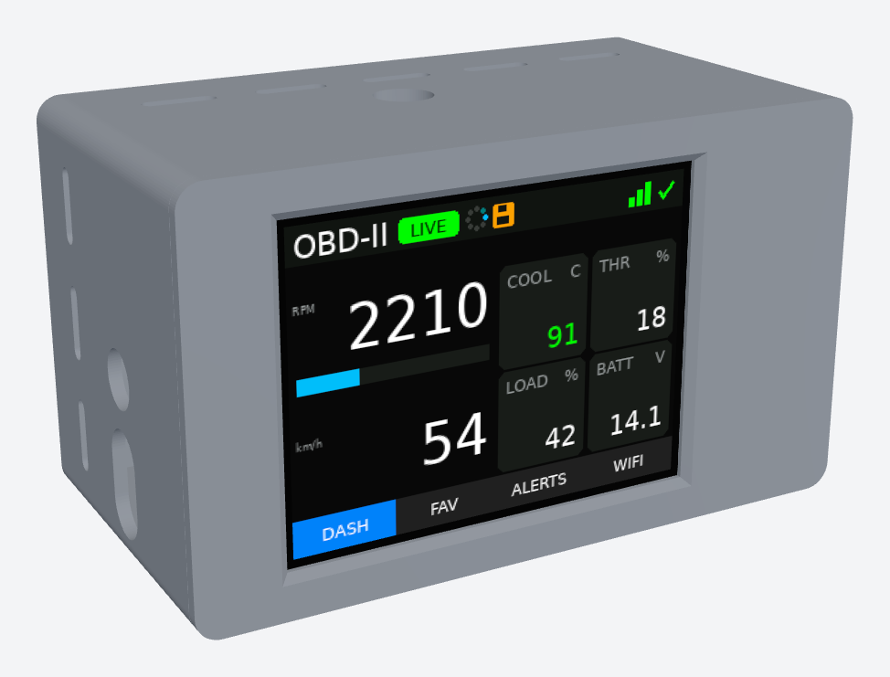</p>

**Contents:** [Features](#features) · [Screen](#screen) · [DEMO / LIVE / LOST](#demo--live--lost-modes) · [Hotspot & web panel](#wifi-hotspot--web-panel) · [Parts](#parts) · [Wiring](#wiring) · [3D-printed case](#3d-printed-case) · [Build & flash](#build--flash) · [Streaming format](#streaming-format)

---

## Features
- Reads OBD-II **Mode 01** PIDs over CAN (500 kbps, 11-bit), plus any PID you type in by hex
- Landscape UI with 4 pages: **DASH · FAV · ALERTS · WIFI**, on a touch screen with a push button
- Header shows the **DEMO / LIVE / LOST** badge, a spinner (the program is running), a save icon (writing to flash) and WiFi status
- **Own WiFi hotspot**: control panel at `http://192.168.4.1` from your phone, with no app and no internet needed
- Joins your home WiFi or phone hotspot (set from the panel **or on the screen** with a touch keyboard)
- **Logs** the PIDs you pick to flash and **streams** them to your URL (JSON POST). Offline? It keeps logging (~700 KB) and uploads everything when WiFi is back
- **Alert rules** (e.g. *Coolant Temp above 105*): buzzer + red bar on the screen + POST to an alerts URL. The push button or a tap silences the buzzer
- Settings survive power-off

---

## Screen

| DEMO | LIVE | LOST | Alert |
|:-:|:-:|:-:|:-:|
| 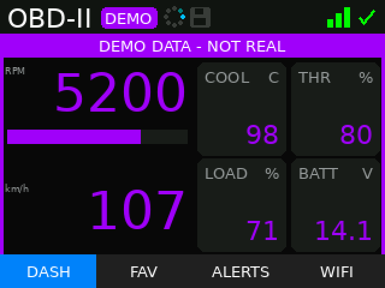 | 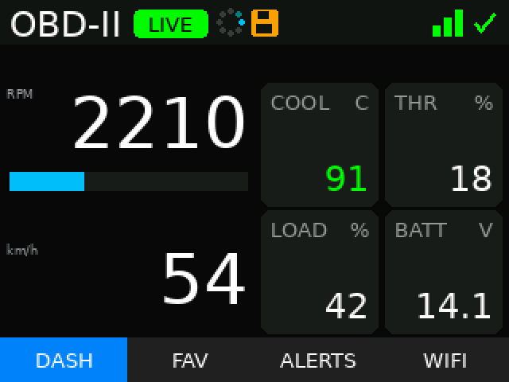 | 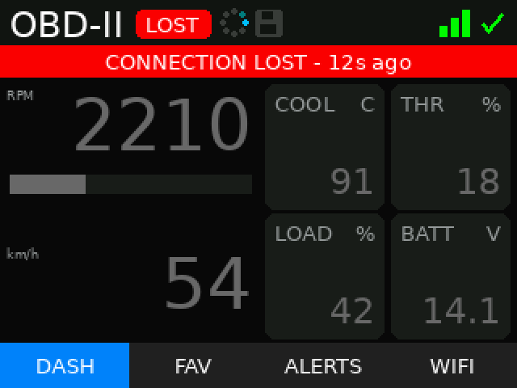 | 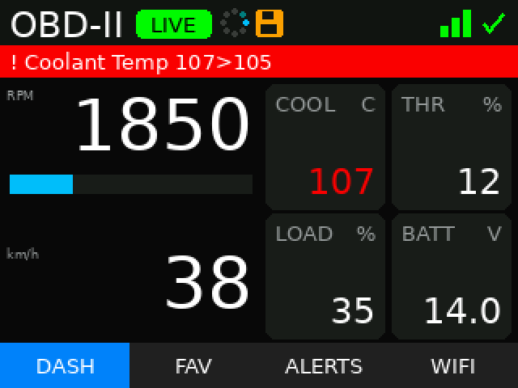 |
| fake data, purple | real data from the car | car stopped answering | rule triggered |

| FAV | ALERTS | WIFI | WiFi keyboard |
|:-:|:-:|:-:|:-:|
| 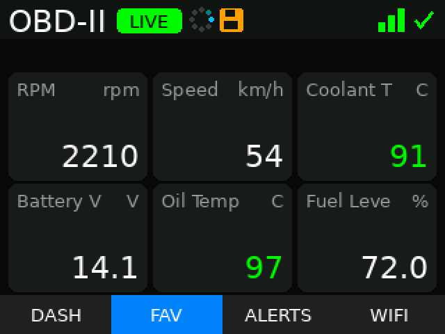 | 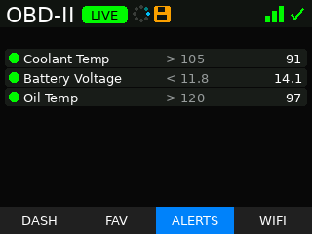 | 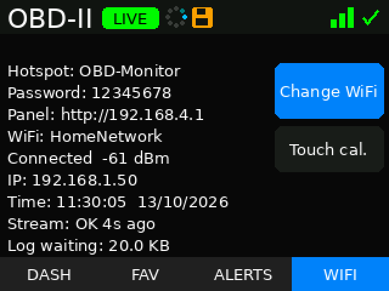 | 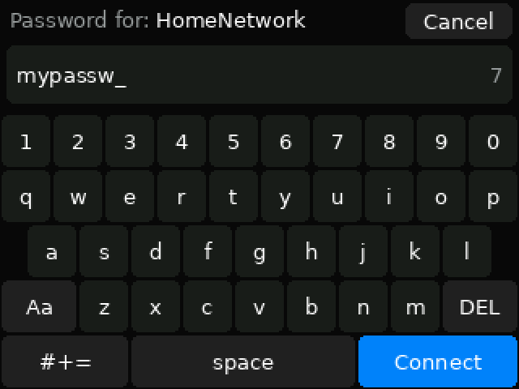 |
| your 6 favourite PIDs | rules + current values | hotspot, WiFi, stream, log status | join a network from the screen |

**Header icons:** mode badge · spinner (turns while the program runs) · save icon (orange while writing to flash) · WiFi bars + ✓ connected / spinner connecting / ✕ not connected.
**Push button:** next page, or silences the buzzer while an alert is beeping.

---

## DEMO / LIVE / LOST modes

| | **DEMO** | **LIVE** | **LOST** |
|---|---|---|---|
| When | From power-on until the car answers | The car answers OBD requests | Was LIVE, then no answer for 3 s |
| Values | Fake, moving test values | Real values from the car | Last real values, frozen |
| Look | **Purple** numbers, purple bar *"DEMO DATA – NOT REAL"*, purple side frame | Normal colours: temps green / orange / red, RPM bar blue → orange → red | **Grey** numbers, red bar *"CONNECTION LOST – 12s ago"* |
| Badge | purple `DEMO` | green `LIVE` | red `LOST` |
| Logging / streaming | Only if *"Also save/stream DEMO data"* is ticked (records are tagged `"mode":"demo"`) | Yes | No new samples (values are stale); data already stored still uploads |
| Alerts | Checked against the fake values | Yes | No new alerts (values are stale) |

**How to get DEMO mode.** There is no switch for it. DEMO is simply what the monitor shows while no car is talking to it:
- Power the ESP32 from **USB on your desk**, or with the CAN board / OBD cable unplugged, or with the car's ignition off. It starts in DEMO, so you can test the screen, alerts, WiFi and streaming without a car.
- As soon as the car's ECU answers, it switches to **LIVE** by itself.
- After it has been LIVE once, it **never goes back to fake data**. If the car stops answering it shows **LOST** with the last real values. Restart it without the car to get DEMO again.
- To keep test data out of your server, untick **Settings → "Also save/stream DEMO data (for testing)"** in the web panel.

---

## WiFi hotspot & web panel

The monitor always runs its own WiFi network:

| | |
|---|---|
| Network | `OBD-Monitor` |
| Password | `12345678` (change it in Settings, 8+ characters, empty = open) |
| Panel | `http://192.168.4.1` |

Connect your phone to it and open the panel. **What you can do there:**

| Live | Query PID | Favorites & Log | Alerts | Settings |
|:-:|:-:|:-:|:-:|:-:|
| 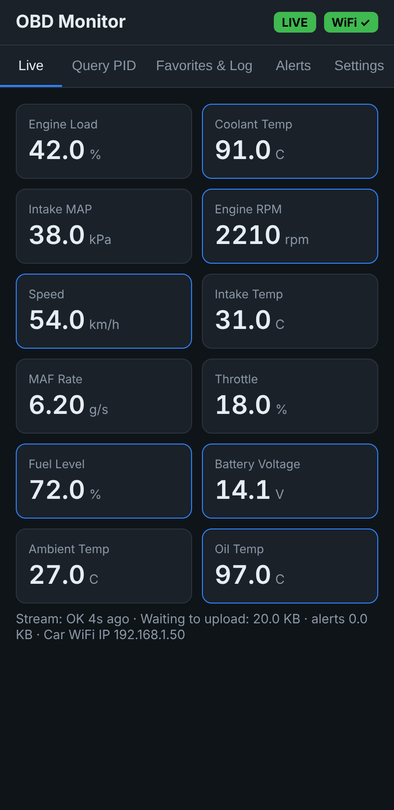 | 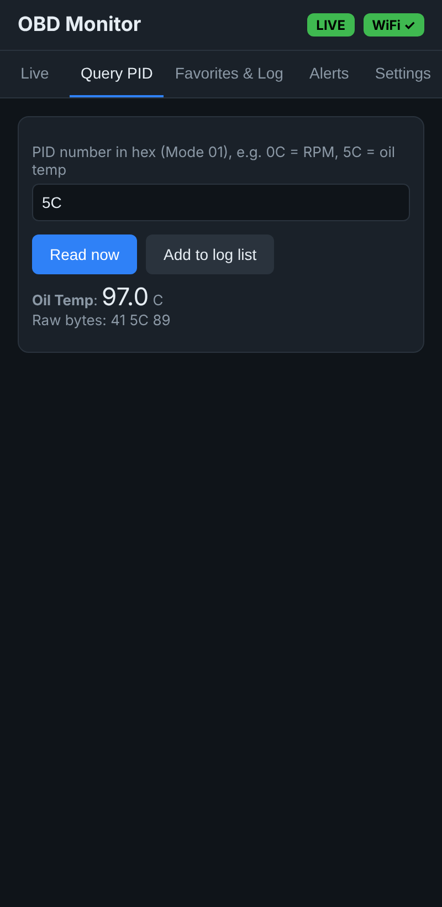 | 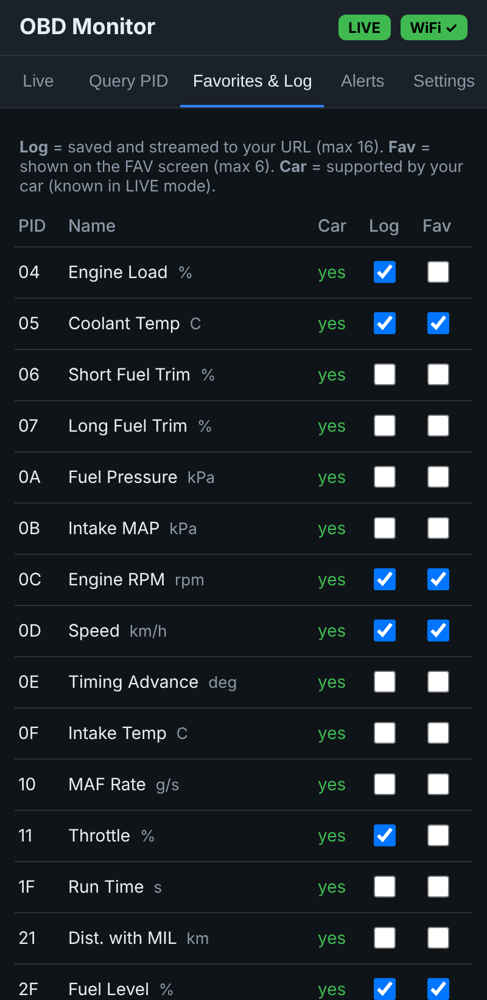 | 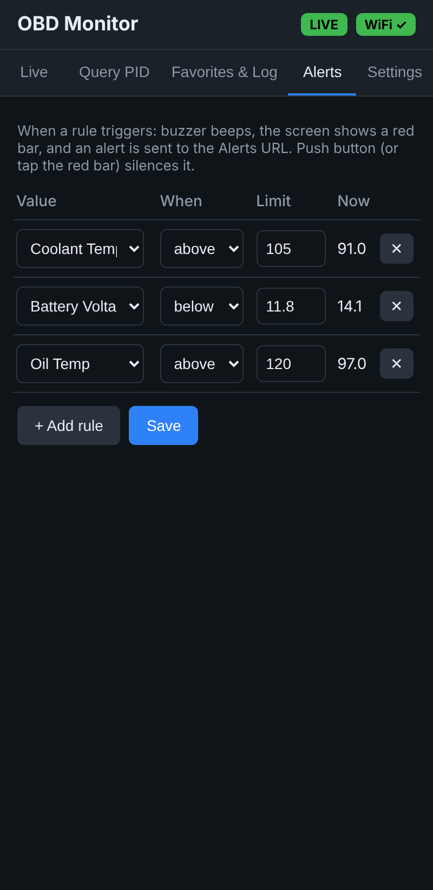 | 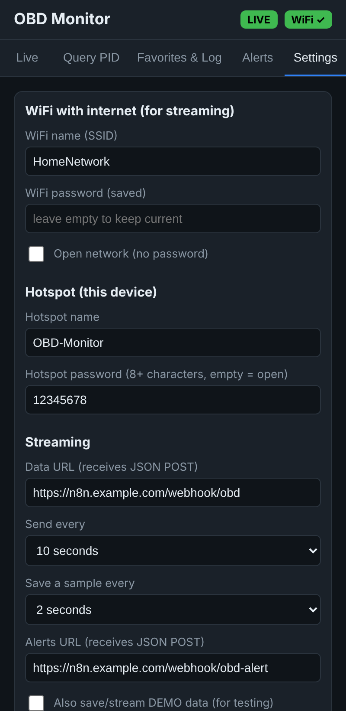 |
| All values being read, mode + WiFi badges, stream / log status | Read any Mode 01 PID by hex (e.g. `5C` = oil temp), see raw bytes, add it to the log list | Tick what to **log/stream** (max 16) and what to show on the **FAV** screen (max 6). *Car* column = PIDs your car supports | Rules like *Coolant Temp above 105* (max 8): buzzer + red bar + POST to the alerts URL | Internet WiFi, hotspot name/password, data URL + send interval, sample interval, alerts URL, demo-data switch |

The hotspot stays on while the monitor is also connected to your internet WiFi (AP + STA). That way the panel always works, even when your phone's hotspot isn't in the car.

---

## Parts

| Part | Used | Size measured for the case (mm) | Notes |
|---|---|---|---|
| ESP32 DevKit, 30-pin | 1 | 51.5 × 28.3 | ESP32-WROOM dev board |
| 2.4" SPI TFT, ILI9341 + touch (14-pin red board) | 1 | PCB 77.18 × 42.72 · visible area 48.96 × 36.72 · 5.5 thick (glass + PCB) | 240 × 320, XPT2046 touch. The visible area is **not centred**: it sits 5.5 mm away from the pin-header end |
| SN65HVD230 CAN transceiver board | 1 | 23.24 × 10.24 | 3.3 V, has CANH / CANL screw terminal |
| LM2596 buck converter | 1 | 43.2 × 21 × 14 (incl. capacitors) | Set to **5.0 V** before connecting |
| Buzzer (active, or 3-pin module) | 1 | Ø 12 × 9.5 | |
| Push button | 1 | 7 mm panel button (Ø 7.2 hole) / 6 × 6 tactile | |
| Fuse + holder | 1 | — | 1 A, in the +12 V line |
| OBD-II male plug / pigtail cable | 1 | cable hole Ø 7 | Pins 4, 5, 6, 14, 16 used |
| Dupont jumper wires | ~20 | 10 cm | The 4.5 cm case depth leaves room for the plugs, no cutting needed |
| PLA filament | — | — | Honeycomb box ≈ 5.1 m · vents box ≈ 9.1 m · lid ≈ 2 m |

---

## Wiring

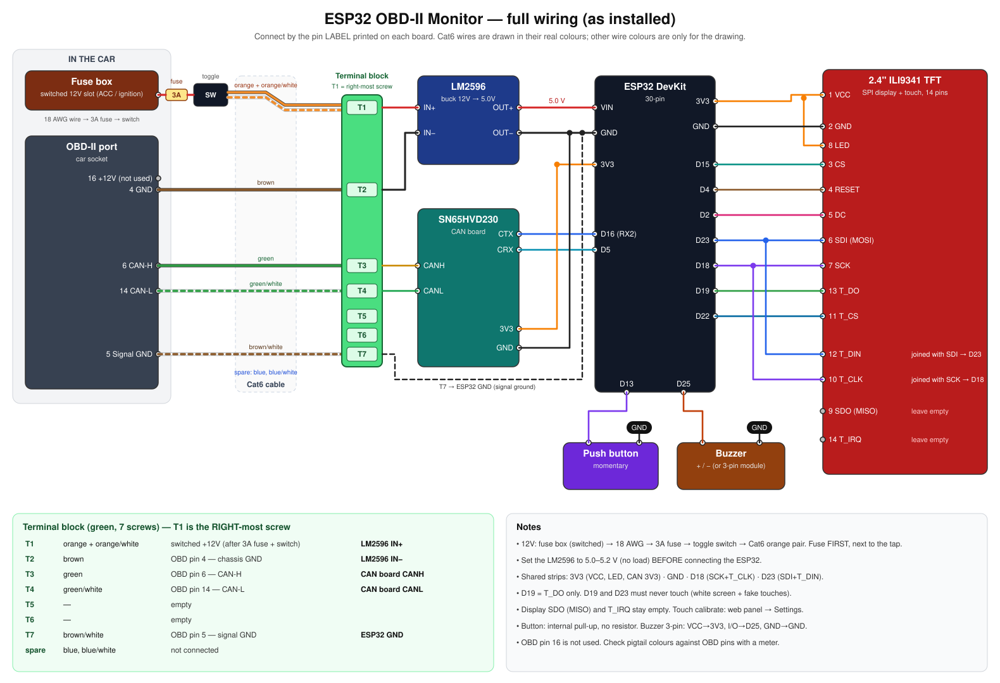

> Connect by the **label printed next to each pin**, not by its position.

| From | Pin | To | Notes |
|---|---|---|---|
| **Display** | VCC | ESP32 3V3 | |
| | GND | ESP32 GND | |
| | CS | D15 | |
| | RESET | D4 | |
| | DC | D2 | |
| | SDI (MOSI) **+ T_DIN** | D23 | the two pins joined |
| | SCK **+ T_CLK** | D18 | the two pins joined |
| | LED | ESP32 3V3 | backlight |
| | T_CS | D22 | touch chip select |
| | T_DO | D19 | touch data out |
| | SDO (MISO) | — | leave **unconnected** (can block the touch chip) |
| | T_IRQ | — | not used |
| **CAN board** (SN65HVD230) | 3V3 | ESP32 3V3 | |
| | GND | ESP32 GND | |
| | CTX / TX | D16 (often labelled RX2) | |
| | CRX / RX | D5 | |
| | CANH | OBD pin 6 | |
| | CANL | OBD pin 14 | |
| **Push button** | leg 1 | D13 | internal pull-up, no resistor (4-leg button: use diagonal legs) |
| | leg 2 | GND | |
| **Buzzer** | + | D25 | 3-pin module: VCC → 3V3, I/O → D25, GND → GND |
| | − | GND | |
| **Power** | OBD pin 16 (+12 V) | 1 A fuse → LM2596 IN+ | never straight to the ESP32 |
| | OBD pin 4 (chassis GND) | LM2596 IN− | |
| | LM2596 OUT+ (5.0 V) | ESP32 VIN | |
| | LM2596 OUT− | ESP32 GND | |
| **Extra ground** | OBD pin 5 (signal GND) | ESP32 GND | |

Pins are also set in [`firmware/obd_monitor/config.h`](firmware/obd_monitor/config.h) (CAN, button, buzzer) and [`firmware/tft_espi_setup/User_Setup.h`](firmware/tft_espi_setup/User_Setup.h) (display).

---

## 3D-printed case

Two parts, no screws: a **box** (pick one style) and a **lid** that snaps in and holds the display.
Outside size **49.3 × 83.8 × 43.4 mm**, walls 1.6 mm, inside depth 41.8 mm (room for dupont plugs).
Both boxes have the same openings: USB-C (low) + OBD cable hole (above) on the left and right ends, a USB-C + OBD pair in the bottom edge, a USB-C + OBD pair in the back, and a buzzer grille. Use whichever opening fits how you mount it.

### Assembled

<table>
<tr><th>Vents box + shifted lid</th><th>Honeycomb box + shifted lid</th></tr>
<tr>
<td></td>
<td>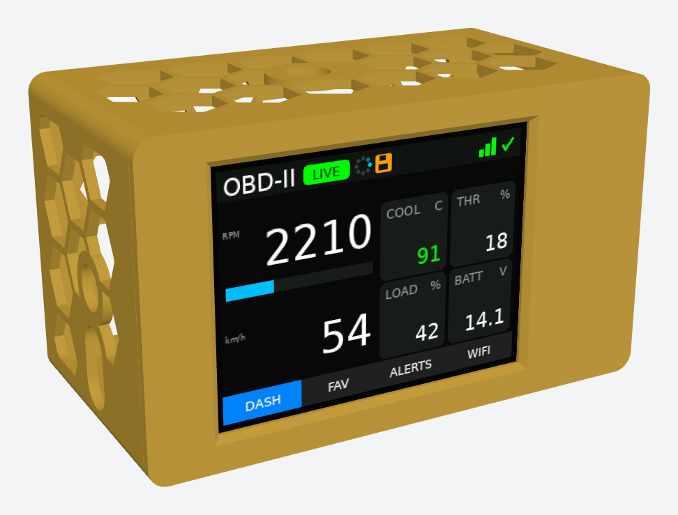</td>
</tr>
</table>

### Box: two styles

<table>
<tr><th>Vents box</th><th>Honeycomb box</th></tr>
<tr>
<td>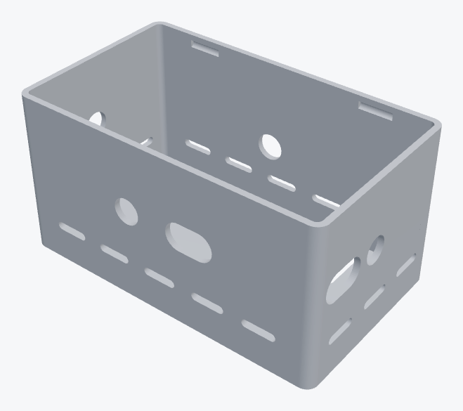</td>
<td>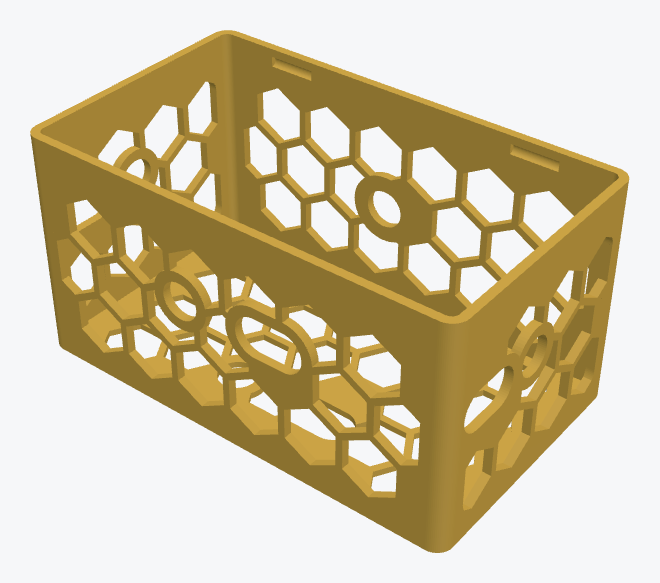</td>
</tr>
<tr><td><code>case/v2/box_original_vents.stl</code> · ≈ 9.1 m PLA</td><td><code>case/v2/box_honeycomb.stl</code> · ≈ 5.1 m PLA</td></tr>
</table>

- **Vents box:** solid walls with rows of slot vents around the sides and back. Stronger and closed-looking.
- **Honeycomb box:** the same box with honeycomb panels in every wall and a 1.2 mm floor. It uses about 45 % less filament and gives more airflow.

### Lid: original vs shifted window

<table>
<tr><th>Original lid (v1)</th><th>Shifted lid (v2) ✅</th><th>Shifted lid: inside</th></tr>
<tr>
<td>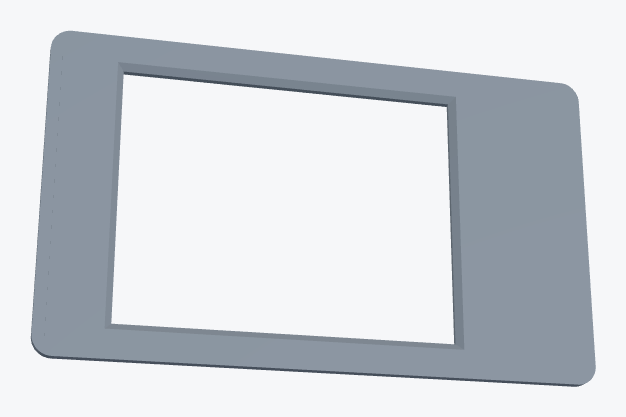</td>
<td>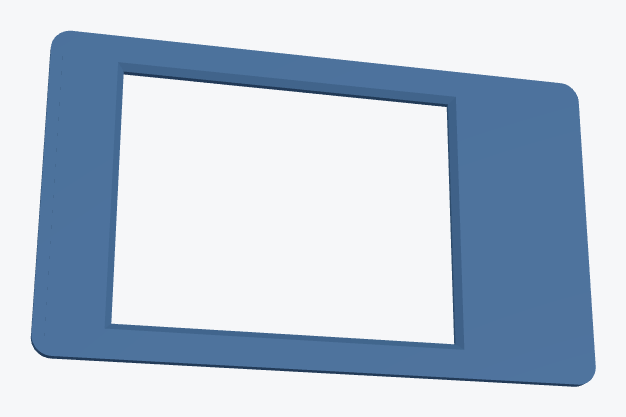</td>
<td>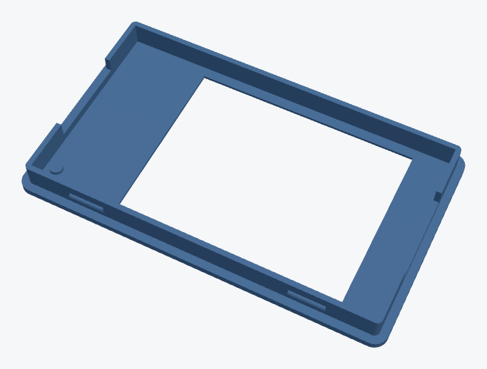</td>
</tr>
<tr><td><code>case/archive/lid_v1_centered.stl</code></td><td><b><code>case/v2/lid_shift5.5.stl</code></b></td><td>rim, click bumps, wire gaps, dot</td></tr>
</table>

How the lid works: a 1.6 mm front plate with the screen window and a bevelled edge. On the inside, a 5.5 mm rim slides into the box (0.2 mm fit gap). The display PCB sits inside the rim, glass against the plate. Four small bumps click into grooves in the box walls. Gaps in the short ends of the rim let the display wires through. A **raised dot** inside marks the pin-header end.

- **Original lid (v1, centred window):** the window is centred on the display PCB. On the real 2.4" board the picture isn't centred, so the screen sat off the window and the plastic covered part of it. Kept only for reference.
- **Shifted lid (v2, tested ✅):** the window (38.7 × 51.0 mm) is **moved 5.5 mm away from the pin-header end**, so it lines up with the actual picture. **Print this one.** Put the display in with its pin header at the dot.

**Printing:** PLA, 0.2 mm layers. Box open side up, lid face down; no supports needed.
To change sizes, edit the numbers at the top of the scripts in `case/v2/` and run them (`pip install manifold3d trimesh numpy`).

---

## Build & flash
1. **Arduino IDE** → board **ESP32 Dev Module**, **esp32 core 2.0.17** (core 3.x gives a white screen with TFT_eSPI).
   Partition scheme: *Default 4MB with spiffs* (or *Huge APP* if the sketch is too big).
2. Install the **TFT_eSPI** library and replace its `User_Setup.h` with [`firmware/tft_espi_setup/User_Setup.h`](firmware/tft_espi_setup/User_Setup.h).
3. Open `firmware/obd_monitor/obd_monitor.ino` and upload.
4. Picture upside down? Set `SCREEN_ROTATION 3` in `config.h`.
   Touch inaccurate? WIFI page → **Touch cal.**, or hold the push button for 2 s while powering on.

## Streaming format
Data URL (every *Send every* seconds, up to 40 records per POST):
```json
{"device":"OBD-Monitor","type":"log","records":[
  {"ts":1760270000,"boot":7,"uptime":512,"mode":"live",
   "values":{"rpm":2210,"speed":54,"coolant":91,"voltage":14.12}}]}
```
Alerts URL (when a rule triggers and when it clears):
```json
{"device":"OBD-Monitor","type":"alert","records":[
  {"ts":1760270012,"event":"triggered","pid":"0x05","key":"coolant","name":"Coolant Temp",
   "condition":">","threshold":105,"value":106,"unit":"C","mode":"live"}]}
```
Your endpoint must answer HTTP 2xx, otherwise the data is kept and sent again. For **n8n**, use a *Webhook* node with method **POST** and the **production** URL (`/webhook/…`, not `/webhook-test/…`).

## Repository layout
```
firmware/obd_monitor/        Arduino sketch + WIRING.txt + README.txt
firmware/tft_espi_setup/     User_Setup.h for TFT_eSPI
case/v2/                     shifted lid, vents box, honeycomb box, generator scripts
case/archive/                original centred lid (v1)
docs/                        wiring.svg + images
```
